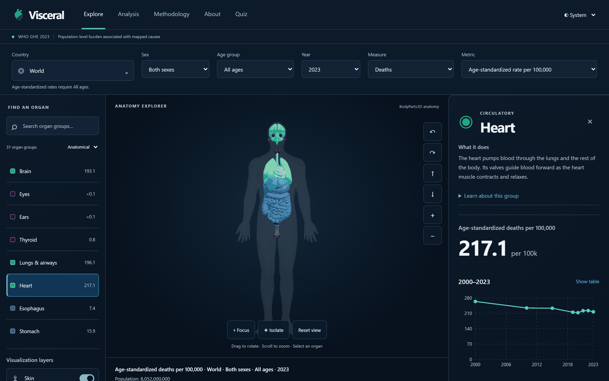
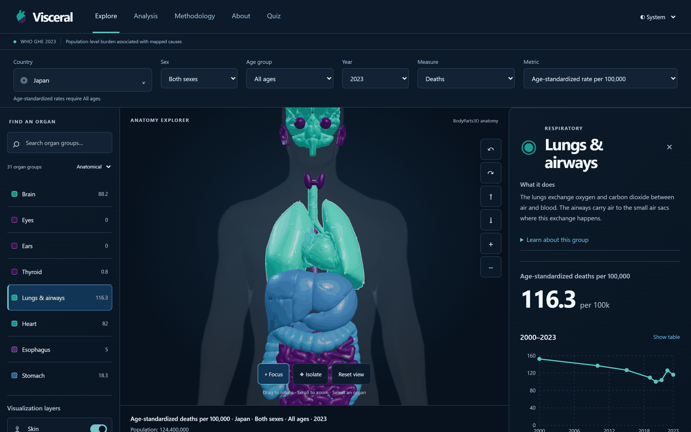
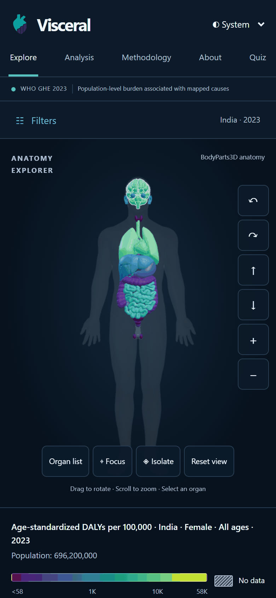
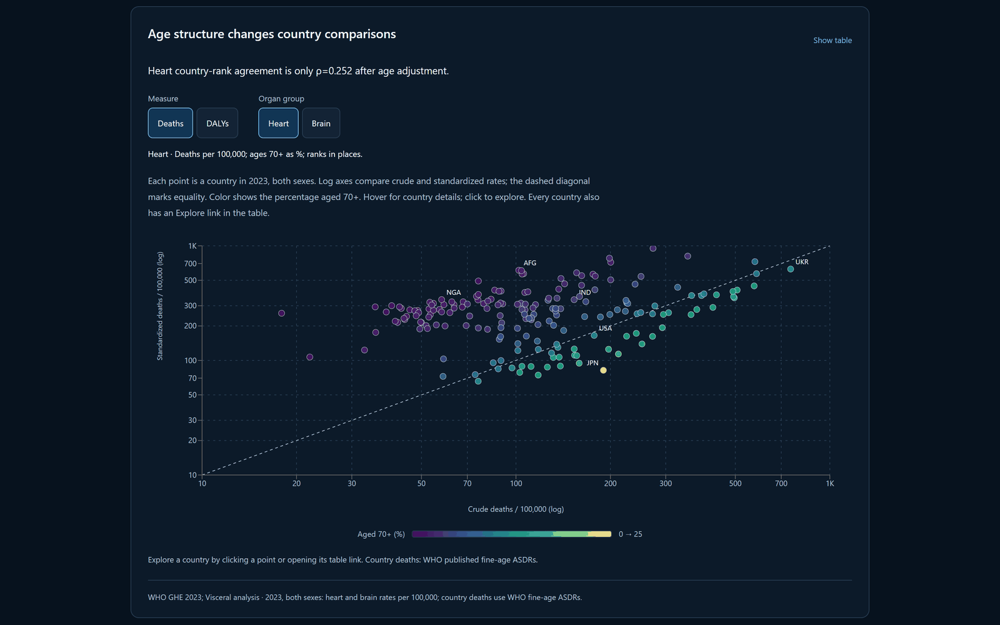
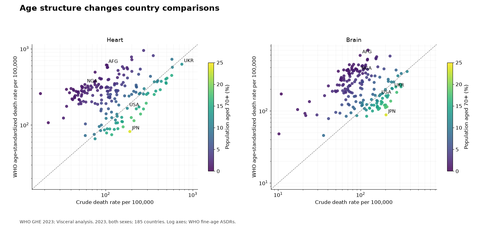
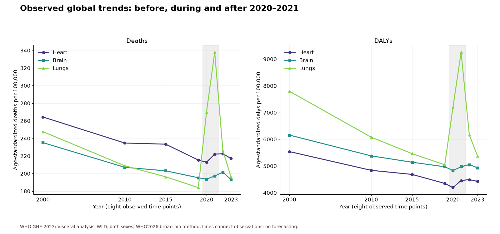
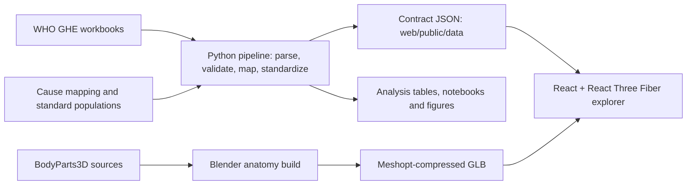

# Visceral

Explore how age structure, sex and analytical choices change the apparent distribution of disease burden across the body, through a reproducible WHO data pipeline and an interactive 3D explorer.

[](https://github.com/narowtow/visceral/actions/workflows/ci.yml)
[](LICENSE)

[**Live demo**](https://narowtow.github.io/visceral/) · [**Analysis write-up**](docs/analysis.md) · [**Notebooks**](pipeline/notebooks/)



<table>
  <tr>
    <td width="66%"></td>
    <td width="34%"></td>
  </tr>
  <tr>
    <td colspan="2"></td>
  </tr>
</table>

Screenshots are reproducible: `npm run build`, `npx vite preview`, then `node scripts/screenshots.mjs` in `web/`.

## The question & key findings

**How do age structure, sex and method choices change where in the body the global burden of disease appears to fall?**

The data cover deaths and DALYs (disability-adjusted life years), attributed to organ and systemic groups. Age-standardized rates (ASDRs) compare populations using a common age distribution; they are not measures of organ health.

- **Age adjustment can reverse a country comparison.** In 2023, both sexes, Japan's heart death rate changes from **189.9 crude to 82.0 age-standardized** per 100,000, while Nigeria's changes from **57.9 to 339.3**. Their ranks among 185 countries move from **43 → 180** and **152 → 46**, respectively, with the highest burden ranked first.
- **Long-term declines and the pandemic tell different stories.** Global death ASDR fell **18.5% for heart, 17.0% for brain and 25.7% for lungs** between 2000 and 2019. Lung ASDR in 2021 was **83.7% above 2019**. COVID-19 accounts arithmetically for **109.6% of that net increase** because other mapped lung causes declined; this is additive accounting, not a causal estimate. These global rates use the broad-bin method.
- **Broad age bins introduce measurable differences.** Against WHO's fine-age country death ASDRs, the seven-bin approximation gives median differences of about **−15% for brain and −14% for heart** across countries in 2023, both sexes. Production country death ASDRs therefore use WHO's published cause rates; the approximation remains explicit for DALYs and World.
- **The standard population can change which group leads.** Holding the broad-bin method fixed, WHO2026 ranks **heart first, lungs second** for global death ASDR in 2023; Segi ranks **lungs first, heart second**. The apparent body profile depends on a stated analytical choice.





See the [write-up](docs/analysis.md) for methods, sex contrasts and limitations, or the [executed notebooks](pipeline/notebooks/) for the underlying tables and code.

## What I built

**A data pipeline with checks at each stage:** parse WHO workbooks → validate tidy tables → map causes → standardize and aggregate → export contract JSON.

- **Scale and reconciliation:** **15,486,720 observations**, 185 countries, 218 cause codes and eight observed years. Across **950,160 cause-level comparisons**, count-derived crude death rates match WHO's published rates to a maximum absolute difference of **5.23 × 10⁻¹² per 100,000**. Published primary-cause ASDR sums reconcile with All Causes within tolerance in **4,421 of 4,440 cases**; the remaining 19 match pinned WHO-file inconsistencies. Unknown or changed discrepancies fail validation. [Full validation report](pipeline/reports/validation.md).
- **An explicit cause-to-organ policy:** 95 primary cause nodes partition the hierarchy across 31 groups. Each leaf is covered once, with no parent/child double counting. The CSV retains every cause and a rationale; systemic and unallocated groups remain visible. This attributes underlying-cause burden, not every organ affected by a disease. [Mapping](pipeline/config/cause_map.csv).
- **Reusable analysis:** Spearman rank comparisons, observed-period changes, sex ratios, PCA and k-means with bootstrap adjusted Rand index (ARI), Ward clustering comparisons, and sensitivity to age bins, five standard populations and an alternative mapping. The selected two-cluster solution has median bootstrap ARI **0.936**, but Ward agreement is only **0.396**—a reason to treat clusters as descriptive patterns. [Analysis code](pipeline/src/visceral_pipeline/analysis/).
- **A web explorer:** React and React Three Fiber render the real BodyParts3D anatomy, built with Blender and compressed to a **1.1 MB GLB** (1,131,696 bytes; 26 mesh nodes). Filters expose country, sex, age, year and measure; a keyboard-accessible HTML organ list, chart tables, view buttons and reduced-motion handling provide alternatives to canvas interaction. Tests decode the shipped model and exercise scene behavior without requiring WebGL.

## Architecture



The [contract](contracts/README.md) fixes identifiers, organ-array order, units and missing-value semantics. Missing data is `null`, distinct from zero. World counts and populations are summed before calculating rates; country rates are never averaged.

## Tech stack

| Area | Tools and purpose |
|---|---|
| Data engineering | Python 3.14, uv, openpyxl, pandas; DuckDB SQL for aggregation and Parquet |
| Validation | Pandera schemas, explicit reconciliation checks, SHA-256 source fingerprints |
| Analysis | NumPy, pandas, scikit-learn, matplotlib, Jupyter notebooks |
| Web | TypeScript, React 19, Vite, React Three Fiber, Three.js, drei, Zustand, Recharts, Tailwind CSS |
| Anatomy | Blender, BodyParts3D, glTF Transform and Meshopt compression |
| Quality & delivery | pytest, Ruff, Vitest, Testing Library, oxlint, GitHub Actions; GitHub Pages deployment workflow |

## Run it locally

Use **Node.js 24**, **Python 3.14+** and [uv](https://docs.astral.sh/uv/). The checked-in derived JSON and GLB let you run the explorer without rebuilding the pipeline or anatomy.

### Web

From the repository root, in PowerShell or a macOS/Linux shell:

```sh
cd web
npm ci
npm run dev
```

Open the local URL printed by Vite. `npm test` runs Vitest once; `npm run build` creates the production site, and `npm run preview` serves that build. Use `npm run dev:fixture` only when you want the explicitly labeled synthetic contract fixture.

### Pipeline and analysis

Raw WHO files are not committed. `acquire --who` downloads all WHO inputs listed in [`sources.yaml`](pipeline/config/sources.yaml), including the reference-rate workbooks and standard-population PDF, into `pipeline/data/raw/who_ghe2023/`. It preserves each full filename while removing the URL query. The five standard populations are already transcribed in [`standard_populations.csv`](pipeline/config/standard_populations.csv).

From the repository root, these commands work in PowerShell and macOS/Linux shells (acquisition needs internet access):

```sh
cd pipeline
uv sync --locked
uv run python -m visceral_pipeline acquire --who
uv run python -m visceral_pipeline build
uv run python -m visceral_pipeline analyze
uv run python -m visceral_pipeline report
```

`build` parses, caches, validates and exports real data; `build --skip-parse` reuses a fingerprint-checked cache. `analyze` regenerates analysis tables, figures, chart JSON, the write-up and five executed notebooks. `report` refreshes the validation report. Once dependencies and raw inputs are present, these stages run offline. See the [pipeline guide](pipeline/README.md) for copied-environment import paths and notebook-execution fallbacks.

With no source flags, `acquire` downloads both WHO and BodyParts3D; `--who` or `--bodyparts3d` selects one. Matching files are skipped. `--force` downloads again but still checks known hashes; a mismatch never replaces the existing file. Null hashes are recorded on first successful acquisition with an explicit message: these are observed fingerprints, not independent verification. Review and commit the new BodyParts3D pins. Known pins are never silently changed.

### Rebuild the anatomy (optional)

From the repository root, acquire BodyParts3D 4.0 and its mapping tables:

```sh
uv run --project pipeline python -m visceral_pipeline acquire --bodyparts3d
```

This downloads both `partof` and `isa` OBJ archives and extracts them into `assets/source/bodyparts3d/obj/{partof|isa}_BP3D_4.0_obj_99/`. Cached matching ZIPs are re-extracted to restore missing OBJ files. Review the first-use hashes recorded in [`sources.yaml`](pipeline/config/sources.yaml). Install the web dependencies before the compression step. See the [anatomy guide](assets/README.md) for source and geometry details.

From the repository root in PowerShell, adjust the Blender executable path to your installation:

```powershell
$blender = 'D:\Blender Foundation\Blender 5.2\blender.exe'
& $blender --background --factory-startup --python-exit-code 1 --python assets/build_anatomy.py -- --source assets/source/bodyparts3d --out assets/build/visceral.raw.glb --report assets/build/report.json
npx --no-install --prefix web gltf-transform meshopt assets/build/visceral.raw.glb web/public/models/visceral.glb
```

On macOS/Linux, replace `& $blender` with `blender` (or your executable's path); the remaining arguments and compression command are identical. Source resolution, geometry derivations and validation commands are documented in [`assets/README.md`](assets/README.md).

## Testing & quality

| Area | Current test count | Coverage |
|---|---:|---|
| Pipeline and analysis | **50**: 18 core + 9 analysis + 23 acquisition | Parsing, schemas, hierarchy partition, standardization, reconciliation, contract exports, ranking, resampling, mapping sensitivity and fake-opener download/extraction checks |
| Web | **46** across 14 files | Data loading, selectors, URL state, filters, keyboard interactions, errors, model decoding and scene runtime |
| Anatomy | **9** source/export tests + **1** Blender-only geometry test | Source resolution, contract mesh names, metadata and connected lung-envelope geometry |

Run `uv run ruff check src tests` and `uv run pytest -q` from `pipeline/`; run `npm run lint`, `npm test` and `npm run build` from `web/`. The [CI workflow](.github/workflows/ci.yml) runs those checks on pushes to `main` and pull requests. It does not rebuild WHO data or run the anatomy suite.

`bash scripts/check.sh` runs the pipeline and web gates from the repository root. On Windows without Bash, run the commands above directly. Anatomy tests run separately with `uv run --project pipeline python -m unittest discover -s assets/tests -v` from the root; the archive test needs complete raw anatomy inputs, and the geometry test requires Blender's Python. See the [anatomy test instructions](assets/README.md#validation).

The [committed validation report](pipeline/reports/validation.md) records real-data checks separately from unit tests: dimensions, unique keys, missingness, sex/age sums, hierarchy reconciliation and agreement with WHO reference rates. Known source inconsistencies remain visible rather than being silently repaired.

## Limitations & honesty

- **Descriptive estimates:** WHO modeled point estimates do not establish causality, individual risk or health-system performance. Source uncertainty intervals are unavailable here. Clustering stability is not uncertainty in WHO's estimates; eight irregular time points do not support forecasting.
- **Cause attribution:** a single underlying cause is assigned to one primary group. This simplifies systemic disease and cannot represent multimorbidity or all affected tissues. Mapping alternatives can change rankings without changing any underlying deaths.
- **Methods differ explicitly:** country death ASDRs sum WHO's fine-age cause rates. DALYs and World use seven broad age bins, including an open 70+ bin. World is the sum of the available countries, not a separately published WHO global estimate.
- **Anatomical limits:** the model is a male reference body; the sex filter changes statistics, not the anatomy. Some groups are list-only. Lung surfaces are derived envelopes of bronchial/vascular trees, and the thyroid is stylized. Neither is a clinical reconstruction.

## Credits & license

WHO supplies the [Global Health Estimates](https://www.who.int/data/global-health-estimates); the derived organ aggregates and interpretations are this project's work, not official WHO figures or an endorsement. WHO data remain subject to [WHO's terms](https://www.who.int/about/policies/publishing/data-policy/terms-and-conditions).

BodyParts3D 4.0, © The Database Center for Life Science, is licensed under **CC BY 4.0**; the model is modified as documented in the [anatomy guide](assets/README.md). The project builds on the open-source libraries listed above. The **[MIT license](LICENSE) covers the project's source code**, not a replacement license for third-party data or anatomy assets. See [THIRD_PARTY_NOTICES.md](THIRD_PARTY_NOTICES.md).

Built by narowtow with AI coding agents (Claude, Codex) for implementation; the project's questions, decisions and review are the author's.

**Medical disclaimer:** this is an educational visualization of population-level burden associated with mapped causes. It provides no diagnosis, treatment advice or individual risk estimates.
